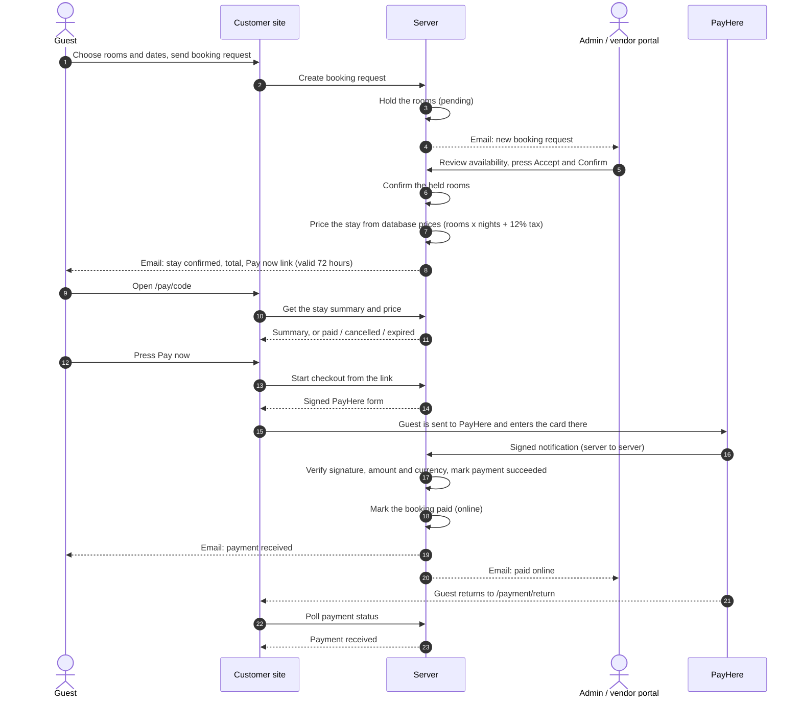

# Online payments

Provider-agnostic payment module in `app/payments/`. PayHere (Sri Lanka) is the first provider. Transport bookings are the first payable target.

## Architecture

```
client  ->  POST /api/v1/payments/checkout  ->  service.initiate_checkout
                                                  |- target (TransportBookingTarget): owner check, amount, currency
                                                  |- registry.get_provider()  ->  providers/payhere.py
                                                  '- payments row (status=initiated)
client  <-  {payment_id, url, method, fields}   (client auto-POSTs the fields to PayHere)

PayHere ->  POST /api/v1/payments/payhere/notify  ->  service.handle_notification
                                                  |- verify md5sig, order, amount, currency
                                                  |- one transaction: payment + booking + payment_events
                                                  '- background task: confirmation email

client  ->  GET /api/v1/payments/{id}/status?email=...   (return page polls this)
admin   ->  GET /api/v1/admin/payments?status=&page=&page_size=
```

| File | Role |
|---|---|
| `base.py` | `PaymentProvider` ABC, `CheckoutInstructions`, `NormalizedPaymentEvent` |
| `registry.py` | `get_provider()` from `PAYMENT_PROVIDER`; `validate_payment_config()` runs at startup |
| `providers/payhere.py` | PayHere hash, md5sig check, status map, currency list |
| `service.py` | Orchestration; never imports a gateway. Payable targets live here |
| `repository.py`, `models.py`, `schemas.py`, `router.py` | Data access, tables, API |

Tables: `payments` (one checkout attempt, unique `order_id`) and `payment_events` (audit of every notification, valid or not). The older `payment_transactions` table is untouched.

Status: `initiated -> pending -> succeeded | failed | cancelled`, and `succeeded -> chargedback`. A final payment never changes again, except a success can be charged back. On success the transport booking gets `payment_status="paid"` and `booking_status="confirmed"` (if it was pending). On chargeback its `payment_status` becomes `chargedback`.

The amount and currency always come from the stored booking. A client-supplied amount is ignored.

Guests: transport bookings are created without sign-in, so checkout and status accept the booking reference and customer email as proof of ownership. A signed-in owner (matching `user_id`) or an admin also works.

## Stays: approve, then pay

Stays are not charged at checkout. The guest sends a request, the team confirms the rooms, and the guest then receives an email with the confirmed price and a secure link to pay on PayHere. Transfers and cart items other than stays still use "Pay Online Now" at checkout.



What each state of the pay page means:

| State | Meaning |
|---|---|
| ready | Approved, unpaid, price verified. The Pay now button is shown. |
| not_approved | The team has not confirmed the rooms yet. |
| paid | A payment for this request already succeeded. |
| cancelled | The request was cancelled; the rooms were released. |
| unavailable | The server cannot verify the price, so the guest is asked to contact you. |
| (HTTP 410) | The link expired. Use **Send payment link** in the portal to issue a new one. |

Rules:
- The amount is always rebuilt on the server. The emailed link only identifies the request; it cannot change the price.
- A stay request cannot be paid online (by link or at checkout) until its status is approved (`quoted` or `converted_to_booking`).
- The link is a signed code (HS256, `SECRET_KEY`) that expires after `PAYMENT_LINK_TTL_HOURS` (default 72). It contains no personal data.
- Rooms stay held while the guest decides. Nothing releases them automatically when a link expires; the team cancels the request to release them.
- The approval email is sent whichever route the team uses (the vendor or admin portal, or the stay booking screen). Re-approving does not send a second email; use **Send payment link** instead.
- After a successful payment the booking created at approval gets `payment_status = succeeded` and `payment_method = online`. A chargeback marks it `refunded`.
- Portal: `POST /api/v1/vendor/booking-inquiries/{id}/payment-link` (admin or the owning vendor) sends a fresh link, and the inquiry list now carries `paymentStatus`.

## Environment variables

| Variable | Meaning |
|---|---|
| `PAYMENT_PROVIDER` | `payhere`, or empty to disable online payments |
| `SECRET_KEY` | Signs emailed payment links; must be a long random value in production |
| `PAYMENT_LINK_TTL_HOURS` | How long a payment link works (default 72) |
| `PAYHERE_MODE` | `sandbox` or `live` |
| `PAYHERE_MERCHANT_ID` / `PAYHERE_MERCHANT_SECRET` | From PayHere, per registered domain |
| `PUBLIC_API_URL` | Public https base URL of this server; builds `notify_url` |
| `CLIENT_RETURN_URL` / `CLIENT_CANCEL_URL` | Customer-site pages after payment |

The server refuses to start if `PAYMENT_PROVIDER=payhere` and the merchant id or secret is missing. Optional: `PAYMENT_NOTIFY_RATE_LIMIT` (default 120) and `PAYMENT_NOTIFY_RATE_WINDOW_SECONDS` (default 60). The limiter is in memory, so it is per server process.

Client (`tour-ceylon-client/.env.local`): `NEXT_PUBLIC_ONLINE_PAYMENTS_ENABLED=true` shows the "Pay online now" option on the transfer review page.

## Testing locally

1. Create a **separate test Postgres** and set `DATABASE_URL`. Never run migrations or tests against production.
2. `alembic upgrade head`
3. Start the server: `uvicorn app.main:app --port 8000`
4. Start a tunnel so PayHere can reach the notify URL: `ngrok http 8000`, then set `PUBLIC_API_URL` to the https address.
5. In the PayHere sandbox dashboard (Integrations > Domains & Credentials) add the domain that starts checkout (`localhost`) and copy the Merchant ID and Secret into `.env`.
6. Run the client, open a transfer, choose **Pay online now**, and pay with a sandbox card:
   - Success: Visa `4916217501611292`, MasterCard `5307732125531191`. Use any future expiry and any CVV.
   - Failure cards: see PayHere's sandbox page.

PayHere sends no status on the return redirect, so the return page polls `/payments/{id}/status`.

### Without PayHere

```
python scripts/simulate_payhere_notify.py ORDER_ID 100.00 USD 2
```

`ORDER_ID` is `order_id` from the checkout response (or the `payments` table). Status codes: `2` success, `0` pending, `-1` cancelled, `-2` failed, `-3` chargedback. The script signs the notification with your `.env` credentials and posts it to `SERVER_URL` (default `http://localhost:8000`).

Tests: `pytest app/tests/test_payment.py app/tests/test_payment_flow.py` (no network, SQLite).

## Adding a provider

1. Create `app/payments/providers/<name>.py` implementing `PaymentProvider` (`create_checkout`, `parse_and_verify_webhook`; `refund` is optional).
2. Add it to `SUPPORTED_PROVIDERS`, `validate_payment_config()` and `get_provider()` in `registry.py`.
3. Add its settings to `config/settings.py` and `.env.example`.
4. Add a public notify route next to `/payhere/notify` in `router.py`. `service.handle_notification` is reused as is.
5. Set `PAYMENT_PROVIDER=<name>`.

Booking code never changes.

## Go-live checklist

- [ ] Live PayHere merchant account approved (a sandbox account cannot be converted).
- [ ] Production domain registered with PayHere; new live Merchant ID and Secret.
- [ ] `PAYHERE_MODE=live`, live credentials set on the server.
- [ ] `PUBLIC_API_URL` is the public https URL of the production server (not localhost or a tunnel).
- [ ] `CLIENT_RETURN_URL` and `CLIENT_CANCEL_URL` point at the live site.
- [ ] Migration applied to the production database after a backup.
- [ ] One real low-value payment checked end to end, including the email and the admin payments list.
- [ ] Decide on a shared rate limiter if running more than one server process.
